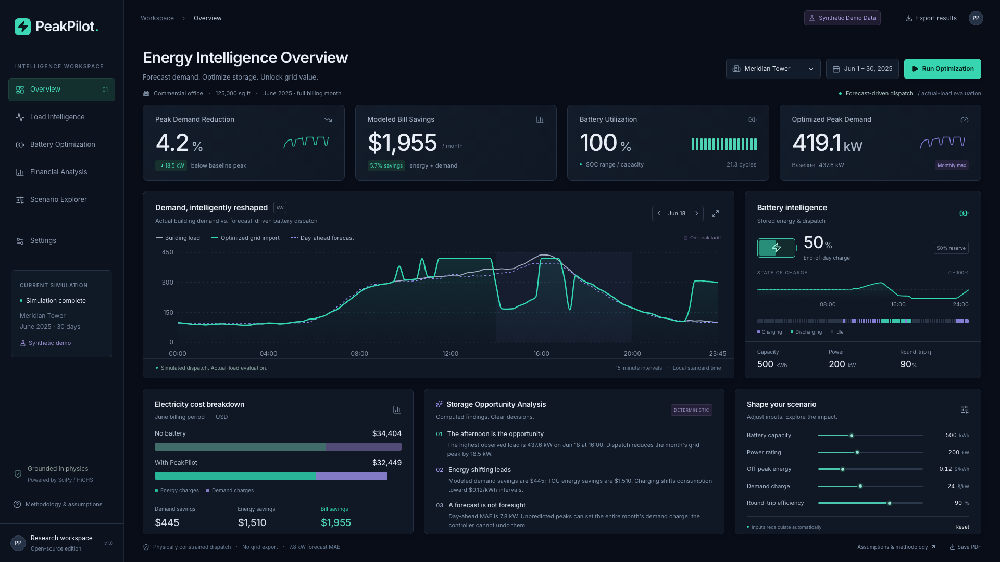
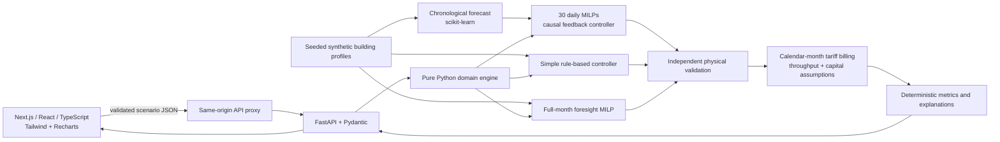

# PeakPilot — Battery Storage Intelligence

**A working energy intelligence dashboard, backed by an inspectable mathematical model.**

PeakPilot forecasts a commercial building's demand, dispatches a battery, and compares the resulting electricity costs. The interface is designed for a clear 1920 × 1080 work-sample screenshot, but the controls run real Python calculations. There are no static savings metrics, accounts, API keys, or LLM dependencies.



> **Research demo, not investment evidence.** All loads are original, reproducible synthetic data. The main dashboard evaluates a forecast-driven controller against actual synthetic holdout loads. The perfect-foresight result is presented separately. Dollar figures cover **June 2025, one complete billing month**.

## Run locally

Requirements: **Python 3.11**, **Node.js 22**, and npm. Use a fresh virtual environment; the original Python 3.9 environment is not compatible with the updated web dependencies. Python 3.13+ is not supported by the pinned SciPy version. `.nvmrc` and `package.json` record the Node major version. No files from a developer’s home directory are required.

```bash
python3.11 -m venv .venv
source .venv/bin/activate
python -m pip install -r backend/requirements-dev.txt
cd frontend
npm ci
cd ..
```

In terminal one:

```bash
source .venv/bin/activate
python -m uvicorn peakpilot.api:app --app-dir backend --host 127.0.0.1 --port 8000
```

In terminal two:

```bash
cd frontend
npm run dev
```

Open **http://localhost:3000**. The initial run fits the model and solves 30 daily MILPs plus a full-month benchmark; it usually takes a few seconds on the tested machine. The API caches up to 12 parameter combinations in memory. Later slider changes debounce for 450 ms, recompute, and update the charts. The last successful result remains visible and is marked as updating during calculation.

For a production-mode local preview:

```bash
cd frontend
npm run build
npm run start
```

For runtime-only installation, use `backend/requirements.txt`; the development requirements add pytest and HTTPX for testing. If you already have an environment created with Python 3.9, create a new Python 3.11 environment instead of reusing it.

The frontend proxies `/api/*` to the FastAPI service. The default is `http://127.0.0.1:8000`; set **`API_URL` before building** for another backend address. Do not put API keys in the frontend. The API documentation is available at http://127.0.0.1:8000/docs.

## What to explore

- **Overview:** actual load, day-ahead forecast, realized grid import, SOC, dispatch timeline, cost breakdown, and computed findings. Choose a day in the chart; KPI cards remain full-month metrics.
- **Load Intelligence:** model MAE, weekly-baseline MAE, RMSE, and exact train/test sample counts.
- **Battery Optimization:** no battery, rule-based, forecast-driven, and perfect-foresight comparisons, including throughput costs.
- **Financial Analysis:** energy/demand breakdown, net operating savings, illustrative capital, O&M, and explicitly conditional payback.
- **Scenario Explorer:** vary capacity, power, off-peak price, monthly demand charge, and round-trip efficiency. Switch among three synthetic building profiles.
- **Settings:** methodology, provenance, JSON export, and PDF export.

The purple forecast legend is an interactive visibility toggle. Tooltips expose interval values. All six navigation items, property selection, date navigation, sliders, reset, rerun, methodology, and export controls are functional.

## Export the work sample

With both services running:

```bash
cd frontend
npx playwright install chromium
npm run screenshot
```

Alternatively, use an existing Chrome installation without downloading a browser:

```bash
CHROME_PATH="/Applications/Google Chrome.app/Contents/MacOS/Google Chrome" npm run screenshot
```

The script runs browser smoke checks and writes:

| Artifact | Purpose |
|---|---|
| `artifacts/peakpilot-dashboard-1920.png` | Exact 1920 × 1080 desktop composition |
| `artifacts/peakpilot-dashboard-3840.png` | Same composition at 2× resolution; recommended PNG submission |
| `artifacts/peakpilot-dashboard-1600.png` | Exact 1600 × 1000 desktop composition |
| `artifacts/peakpilot-dashboard.pdf` | Single-page, landscape, high-resolution PDF |
| `artifacts/peakpilot-mobile.png` | Full mobile layout at 390 CSS pixels |
| `artifacts/browser-verification.json` | Actual checks, layout dimensions, and browser diagnostics |

For a quick manual export, choose **Save PDF**, select landscape, enable background graphics, disable browser headers/footers, and fit to one page. The scripted PDF gives the most reproducible composition. **Export results** downloads the full calculation, parameters, all intervals, and assumptions as JSON.

## Architecture



```text
backend/
  peakpilot/engine.py      # data, forecasting, optimization, controls, billing
  peakpilot/api.py         # bounded inputs, stateless endpoints, in-memory cache
  tests/test_engine.py     # analytic, physics, leakage, and API tests
  requirements.txt
frontend/
  app/page.tsx             # interactive dashboard and analytical views
  app/globals.css          # responsive desktop-first visual system
  app/types.ts             # typed API result contract
  scripts/capture.mjs      # browser verification + PNG/PDF capture
scripts/benchmark.py       # reproduce numerical report without the UI
docs/                     # screenshot and generated benchmark snapshot
```

The domain functions have no dependency on FastAPI or UI state. No numerical claims are generated by an LLM. Fonts are bundled through `@fontsource/inter`; viewing the dashboard does not require a font CDN.

## Data provenance and assumptions

**Source:** original synthetic generator `synthetic_load()` in `backend/peakpilot/engine.py`, released under this repository's MIT license. No proprietary company code, utility customer data, or external datasets are included. Building names, floor areas, and types are fictional scenario labels, not calibrated real buildings.

- April 1–June 30, 2025: 91 days, **8,736 observations**, each an interval-average kW reading.
- Seeds: office 42, retail 73, warehouse 109.
- Load combines a continuous base load, sigmoid occupancy, reduced weekend occupancy, an afternoon cooling component, day-level variation, correlated measurement/process noise, and occasional equipment events.
- Cooling uses a synthetic daily weather driver; that future driver is **not supplied to the forecasting model**.
- Local standard time; no daylight-saving transitions, holidays, meter gaps, export, or solar generation.
- The demo accepts scenario parameters, not uploaded customer data. CSV ingestion is intentionally outside this smaller screenshot-focused version.

## Forecast methodology

The model is `HistGradientBoostingRegressor` with fixed hyperparameters, random state 42, and early stopping disabled to avoid an automatic random validation split on larger datasets. It is fit once on April–May; the first seven days provide lag history and are excluded from training, leaving **5,184 training examples**. June's **2,880 intervals** are the chronological forecast holdout. This is a synthetic development benchmark, not an independently collected external test set.

At midnight, the model predicts all 96 quarter-hours of the next day. Features are yesterday's matching interval, last week's matching interval, the previous seven matching intervals' average, cyclical hour, weekday, and a weekday flag. Every feature for a forecast day is available before that day's midnight. There is no target-day rolling mean, future weather, random train/test shuffle, or holdout-driven tuning.

Prior June days become observed history for subsequent June predictions. This is a daily rolling-origin evaluation with a **fixed trained model**, not a single 30-day forecast made on June 1. The naive comparator is same-time-last-week. MAE and RMSE are calculated against actual June loads. Tests mutate future observations and verify that earlier features and first-day predictions remain unchanged.

## Optimization formulation

For interval `t`, AC charging/discharging power `c_t`, `d_t` (kW), stored DC energy `E_t` (kWh), binary mode `z_t`, and monthly grid peak `p_m` (kW):

```text
minimize  Σ_t [r_t g_t Δt + w(c_t + d_t)Δt] + Σ_m D p_m

g_t       = load_t + c_t − d_t                  ≥ 0
E_(t+1)   = E_t + η_c c_t Δt − d_t Δt / η_d
0 ≤ E_t   ≤ capacity
0 ≤ c_t   ≤ power × z_t
0 ≤ d_t   ≤ power × (1 − z_t)
p_m       ≥ g_t for each t in month m
p_m       ≥ actual peak already observed in month m
E_0       = 50% × capacity
E_midnight ≥ 50% × capacity
z_t ∈ {0, 1}, Δt = 0.25 hours
η_c = η_d = sqrt(round_trip_efficiency)
```

The energy term includes the constant building-load cost when reporting the solver objective. Sparse linear constraints are solved by **SciPy `milp` / HiGHS**, with a 0.01% relative optimality tolerance and 30-second limit per solve. A solver timeout or unverified incumbent is surfaced as an error; it is not silently presented as optimal.

The midnight requirement is a **minimum**, not an equality. Extra energy is allowed and receives no salvage credit. All battery strategies start with the same energy and face the same midnight reserve. Thus initial energy is not freely depleted to make savings look better. The oracle's feasible set contains the realized forecast and rule trajectories; its minimum operating cost is a theoretical lower bound within solver tolerance.

### Forecast-driven execution and its limits

Every day, a new MILP uses that day's forecast, the actual carried SOC, and the monthly peak already observed. A causal safety controller follows the planned SOC, caps charging against the planned daily grid peak, reacts to current observed peaks, prevents export, and preserves enough remaining charging time to reach the overnight reserve. If reserve recovery requires exceeding the target peak, physical feasibility takes priority.

This is a daily plan with **idealized current-interval feedback**, not an open-loop schedule or full receding-horizon MPC. Knowing the current interval-average load is a simulation abstraction; sensor delay, intra-interval variation, ramping, and control latency are not modeled. The controller does not read future actual loads. Forecast-driven dispatch is not globally optimal, and early-month errors can determine the entire demand bill.

The rule-based comparator charges between 00:00 and 06:00, then shaves demand above the **training-period** 85th percentile between 12:00 and 21:00, retaining the reserve throughout. Its threshold is not fitted on the holdout.

## Tariff and economic accounting

- Default off-peak energy: **$0.12/kWh**.
- Weekdays 14:00–20:00: **2.5 × off-peak**, default **$0.30/kWh**. All weekend hours are off-peak.
- Default demand charge: **$24/kW × the calendar-month maximum grid import**. It is not multiplied by the number of days.
- Throughput allowance: **$0.008 for each AC kWh charged or discharged**. This is a linear wear allowance, not a detailed degradation model.
- Utility bill savings = no-battery bill − battery bill. Net operating savings subtract throughput cost as well.
- Utilization = observed SOC range / energy capacity. Equivalent cycles use DC discharge energy / capacity. Neither is a power capacity factor.
- Illustrative capital = **$350/kWh + $150/kW + $15,000 fixed installation**; annual O&M = **1.5% of capital**.
- Payback is explicitly a **repeat-June illustration**: capital / `(12 × June net operating savings − annual O&M)`, and is absent for a nonpositive denominator. This is not a measured annual saving or a seasonal model.

The decision panel is assembled from verified numeric outputs: peak timing, modeled demand/energy savings, tariff timing, and holdout error. It makes no LLM-analysis claim.

## Reproduce the numerical benchmark

```bash
source .venv/bin/activate
python scripts/benchmark.py --output docs/benchmark.json
```

The default run, verified during implementation, produced:

| Quantity | Result |
|---|---:|
| No-battery June bill | $34,403.70 |
| Forecast-driven June bill | $32,448.68 |
| Forecast-driven bill savings | $1,955.01 |
| Forecast-driven net operating savings | $1,784.18 |
| Peak reduction | 18.546 kW / 4.24% |
| Forecast MAE | 7.804 kW |
| Weekly-naive MAE | 10.892 kW |

These are **measured program outputs on synthetic data**, not hardcoded display values. Solver tie-breaking can change individual dispatch intervals slightly. The generated benchmark records all strategy costs, parameters, and runtime versions.

The gap to perfect foresight is a useful finding: a relatively small mean forecast error does not imply equally small economic error. A few unanticipated peak intervals dominate the demand charge. The dashboard makes that gap inspectable instead of presenting foresight savings as achievable control performance.

## Verification

```bash
source .venv/bin/activate
python -m pytest -q
cd frontend
npm run format:check
npm run typecheck
npm run build
# With both services running:
npm run screenshot
```

Backend tests cover independent energy/grid conservation, charge/discharge exclusivity, rate units, power/SOC limits, midnight reserve, monthly demand billing, calendar boundaries, TOU boundaries, an analytically known optimum, reconstructed objective equality, infeasible constraints, nonfinite/invalid inputs, extreme forecast-error replay, future-data leakage, deterministic generation, oracle comparisons, and API validation.

The screenshot script checks a real capacity-change API response and altered metrics, building selection, all navigation views, forecast toggle, day navigation, the methodology dialog, JSON download, browser errors, and overflow at 1920×1080, 1600×1000, and 390px mobile. It exports only after the initial calculation completes.

GitHub Actions runs backend tests, frontend formatting, generated route types, TypeScript checking, and the production build. `npm run typecheck` generates Next.js types first, so it also works before a first build. Browser checks are a separate local step because they require both services and Chromium.

## Deployment and publishing

The project is ready for a two-service deployment; **no hosted deployment or GitHub repository is created automatically**.

### Docker Compose

```bash
docker compose up --build
```

Open http://localhost:3000. This path requires Docker and is provided for reproducibility; see `docs/VERIFICATION.md` for whether Docker itself was exercised in the build environment.

### Separate hosting

1. Deploy `backend/` to a Python service using Python 3.11, `pip install -r requirements.txt`, and `uvicorn peakpilot.api:app --host 0.0.0.0 --port "$PORT"` from that directory.
2. Deploy `frontend/` to a Node/Next.js host. Set `API_URL` to the backend's HTTPS origin **at build time**; run `npm ci && npm run build`, then `npm run start` where applicable.
3. Confirm backend `/health`, dashboard first load, a changed battery capacity, and a JSON export in the deployed environment.
4. For a public service, add request rate limits and a bounded work queue. The included demo serializes solves with a lock and keeps a small in-memory cache; it is not an internet-scale job service. Consider private backend ingress behind the frontend proxy.

See [the publication checklist and exact GitHub commands](docs/PUBLISHING.md). No remote repository, commit, or push is performed by the application or its setup scripts. `.gitignore` excludes local environments, build outputs, credentials, caches, and disposable exports. The curated README screenshot and numerical benchmark live in `docs/` and can be committed. The [publication audit](docs/PUBLICATION_AUDIT.md) records the clean-environment checks and outstanding limitations.

## Deliberate limitations

Synthetic profiles are not calibrated engineering models of real facilities. There is no real meter ingestion, weather feed, persistence, authentication, forecast uncertainty ensemble, annual simulation, or full tariff engine. Tariff ratchets, holidays, taxes, incentives, export, grid services, battery aging, replacement, financing, and warranties are excluded. Capacity/power limits bound the API input size; the month and 15-minute resolution are fixed. Solver jobs already running continue after a browser request is cancelled. There is no claim of production dispatch readiness or real-world investment performance.

Good next experiments would be a licensed year-long meter dataset, a quantile forecast with calibrated coverage, a rolling MPC controller, and sensitivity to forecast errors at the monthly peak. Those are extensions, not features claimed by this version.

## References

- [SciPy `milp` documentation](https://docs.scipy.org/doc/scipy/reference/generated/scipy.optimize.milp.html): solver API and integrality/constraint semantics.
- [scikit-learn time-series splitting](https://scikit-learn.org/stable/modules/generated/sklearn.model_selection.TimeSeriesSplit.html): chronological evaluation rationale. PeakPilot implements its explicit calendar split directly.

## License

MIT. Original project and synthetic generator; not affiliated with Powertown or any building/operator named in the demo.
